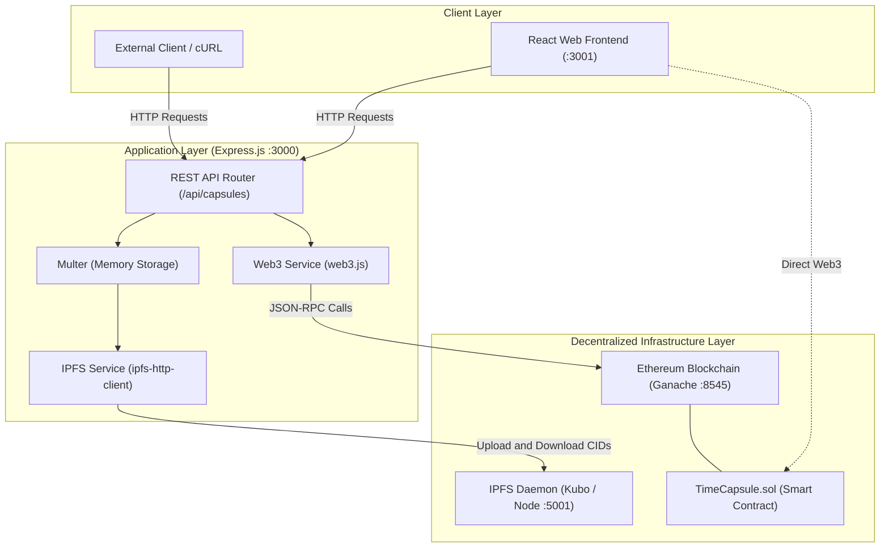
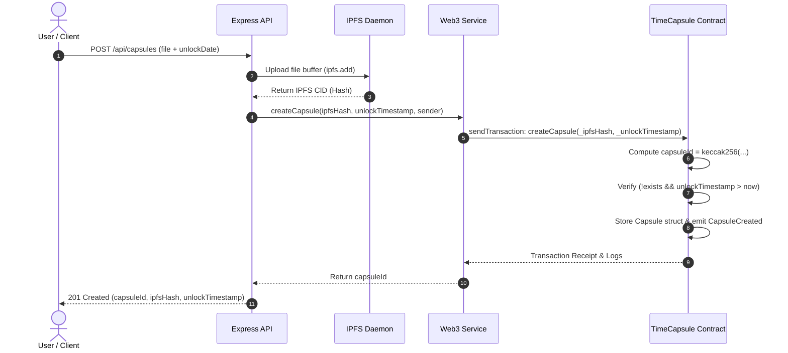
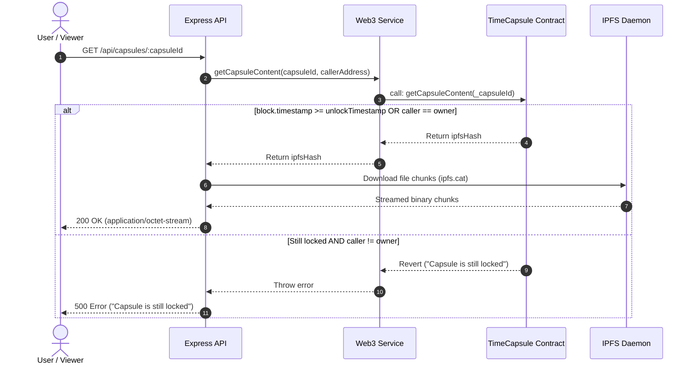

# ⏳ Time Capsule

A decentralized, tamper-proof digital time capsule platform powered by **Ethereum** smart contracts and **IPFS** (InterPlanetary File System). 

Time Capsule allows users to upload digital assets and seal them securely with a time-lock. Files are preserved immutably across distributed storage, while smart contracts strictly enforce access control—ensuring that locked content cannot be accessed by unauthorized parties until the designated unlock timestamp has passed.

---

## 📑 Table of Contents

- [Overview & Key Features](#-overview--key-features)
- [System Architecture & Design](#-system-architecture--design)
  - [Architecture Overview](#architecture-overview)
  - [Capsule Creation Flow](#capsule-creation-flow)
  - [Capsule Retrieval & Unlock Flow](#capsule-retrieval--unlock-flow)
  - [Core Components](#core-components)
- [Project Directory Structure](#-project-directory-structure)
- [Smart Contract Specification](#-smart-contract-specification)
- [REST API Reference](#-rest-api-reference)
- [Prerequisites](#-prerequisites)
- [Step-by-Step Setup & Run Guide](#-step-by-step-setup--run-guide)
  - [1. Clone Repository & Install Dependencies](#1-clone-repository--install-dependencies)
  - [2. Configure Environment Variables](#2-configure-environment-variables)
  - [3. Start Ganache Blockchain](#3-start-ganache-blockchain)
  - [4. Start IPFS Node](#4-start-ipfs-node)
  - [5. Compile and Deploy Smart Contracts](#5-compile-and-deploy-smart-contracts)
  - [6. Run Automated Tests](#6-run-automated-tests)
  - [7. Start the Backend API Server](#7-start-the-backend-api-server)
  - [8. Start the Frontend Application](#8-start-the-frontend-application)
- [Verification & Usage Examples](#-verification--usage-examples)
- [Troubleshooting](#-troubleshooting)
- [License](#-license)

---

## 🚀 Overview & Key Features

- **Immutable Distributed Storage**: Files are pinned to IPFS, ensuring tamper-proof content-addressable storage via cryptographic CIDs (Content Identifiers).
- **Time-Locked Access Control**: Smart contract rules strictly guard the IPFS hash. Time locks are verified deterministically on the Ethereum blockchain using block timestamps.
- **Dual-Permission Model**:
  - **Creator Access**: The capsule owner can view and retrieve their capsule content at any time.
  - **Public / Recipient Access**: The public or other viewers can only view and unlock content after the target unlock timestamp has passed.
- **Unique Hash Identification**: Each capsule is uniquely identified by `keccak256(abi.encodePacked(_ipfsHash, _unlockTimestamp, msg.sender))`, preventing collisions and duplicate capsules.
- **Full-Stack Architecture**: Complete with a Solidity smart contract, an Express.js REST API with file upload middleware, and a React frontend dashboard.

---

## 🏗️ System Architecture & Design

### Architecture Overview



---

### Capsule Creation Flow



---

### Capsule Retrieval & Unlock Flow



---

### Core Components

1. **Smart Contract (`contracts/TimeCapsule.sol`)**:
   - Manages capsule records (`ipfsHash`, `unlockTimestamp`, `owner`, `exists`).
   - Prevents duplicate registrations and early access by unauthorized parties.
   - Emits indexable events (`CapsuleCreated`, `CapsuleUnlocked`).

2. **Backend Server (`app/app.js`)**:
   - Exposes RESTful endpoints for capsule creation, listing, status verification, and content downloads.
   - Handles multi-part file uploads securely in memory using `multer`.
   - Hardened with security middlewares (`helmet`, `cors`, `morgan`).

3. **IPFS Service (`app/services/ipfsService.js`)**:
   - Communicates with IPFS RPC API over HTTP (`localhost:5001`).
   - Handles file chunking, CID generation, and binary file streaming.

4. **Web3 Service (`app/services/web3Service.js`)**:
   - Interacts with local EVM / Ganache node on port `8545`.
   - Dynamically loads compiled contract ABIs and network addresses from `build/contracts/TimeCapsule.json`.

5. **Frontend Client (`time-capsule-frontend/`)**:
   - React 17 single-page application.
   - Forms to seal capsules, inspect lock status, view active capsules, and retrieve unlocked contents.

---

## 📂 Project Directory Structure

```text
time-capsule/
├── app/                                  # Express.js REST API Backend
│   ├── controllers/
│   │   └── capsuleController.js          # Business logic for capsule endpoints
│   ├── routes/
│   │   └── capsuleRoutes.js              # Express routing definitions (/api/capsules)
│   ├── services/
│   │   ├── ipfsService.js                # IPFS client module (add/cat operations)
│   │   └── web3Service.js                # Contract interface using Web3.js
│   └── app.js                            # Express application setup & middleware
├── contracts/                            # Solidity Smart Contracts
│   ├── Migrations.sol                    # Truffle migration tracking contract
│   └── TimeCapsule.sol                   # Time Capsule core logic (time-lock & access)
├── migrations/                           # Truffle Migration Scripts
│   ├── 1_initial_migration.js            # Deploys Migrations.sol
│   └── 2_deploy_contracts.js             # Deploys TimeCapsule.sol
├── test/                                 # Automated Test Suite
│   └── time_capsule.js                   # Truffle unit tests for TimeCapsule
├── time-capsule-frontend/                # Frontend Application Container
│   └── time-capsule-frontend/            # React Single Page Application (SPA)
│       ├── public/
│       │   ├── favicon.ico               # Application favicon
│       │   └── index.html                # HTML document template
│       ├── src/
│       │   ├── components/
│       │   │   ├── CapsuleDetails.jsx    # Displays capsule details and lock status
│       │   │   ├── CapsuleForm.jsx       # Form to submit and seal a new capsule
│       │   │   └── CapsuleList.jsx       # Lists user's owned capsules
│       │   ├── services/
│       │   │   └── web3Service.js        # Client-side Web3 contract interaction
│       │   ├── styles/
│       │   │   └── App.css               # User interface styling
│       │   ├── App.jsx                   # Main React router & layout
│       │   └── index.js                  # React DOM entry point
│       ├── package.json                  # Frontend dependencies and scripts
│       └── README.md                     # Frontend documentation
├── .gitignore                            # Git ignore specifications
├── package.json                          # Backend & Truffle npm configuration
├── package-lock.json                     # Locked dependency tree
├── README.md                             # Main project documentation
└── truffle-config.js                     # Truffle EVM compiler and network settings
```

---

## 📜 Smart Contract Specification

### `TimeCapsule.sol`

- **Solidity Version**: `^0.8.0`
- **Compiler Optimization**: 200 runs

#### Struct: `Capsule`
```solidity
struct Capsule {
    string ipfsHash;          // IPFS CID of stored data
    uint256 unlockTimestamp;  // Unix timestamp (seconds) when capsule unlocks
    address owner;            // Address of the creator
    bool exists;              // Existence flag
}
```

#### Functions
| Function | Visibility | Description |
|---|---|---|
| `createCapsule(string memory _ipfsHash, uint256 _unlockTimestamp)` | `external` | Validates hash and future timestamp, computes `capsuleId`, persists capsule, and emits `CapsuleCreated`. |
| `getCapsuleContent(bytes32 _capsuleId)` | `external view` | Returns `ipfsHash` if current timestamp ≥ `unlockTimestamp` or if `msg.sender == owner`. Reverts if locked. |
| `getMyCapsules()` | `external view` | Returns an array of `bytes32` capsule IDs owned by `msg.sender`. |
| `isCapsuleUnlocked(bytes32 _capsuleId)` | `external view` | Returns `true` if `block.timestamp >= unlockTimestamp`, otherwise `false`. |

#### Events
- `event CapsuleCreated(bytes32 indexed capsuleId, address indexed owner, uint256 unlockTimestamp);`
- `event CapsuleUnlocked(bytes32 indexed capsuleId, address indexed viewer);`

---

## 🔌 REST API Reference

Base URL: `http://localhost:3000/api/capsules`

### 1. Create a Time Capsule
- **URL**: `POST /`
- **Content-Type**: `multipart/form-data`
- **Form Fields**:
  - `file`: File to encapsulate (Binary buffer)
  - `unlockDate`: Target unlock date/time string (e.g., `2030-01-01T00:00:00Z` or `3000-01-01`)
- **Response** `201 Created`:
  ```json
  {
    "success": true,
    "capsuleId": "0x4b7f8...",
    "ipfsHash": "QmXoypizjW3WknFiJnKLwHCnL72vedxjQkDDP1mXWo6uco",
    "unlockTimestamp": 1893456000
  }
  ```

### 2. Retrieve Capsule Content
- **URL**: `GET /:capsuleId`
- **Description**: Downloads the encapsulated file from IPFS if caller is the owner or if unlock timestamp has elapsed.
- **Response**: Binary stream (`Content-Type: application/octet-stream`).
- **Error Response** (`500` / revert):
  ```json
  {
    "error": "Something went wrong!"
  }
  ```

### 3. List User Capsules
- **URL**: `GET /`
- **Description**: Retrieves all capsule IDs associated with the current user account.
- **Response** `200 OK`:
  ```json
  {
    "capsules": [
      "0x4b7f8...",
      "0x8a1b2..."
    ]
  }
  ```

### 4. Check Capsule Unlock Status
- **URL**: `GET /:capsuleId/status`
- **Description**: Checks whether a capsule has passed its unlock timestamp.
- **Response** `200 OK`:
  ```json
  {
    "isUnlocked": false
  }
  ```

---

## ⚙️ Prerequisites

Ensure you have the following installed on your system:

1. **Node.js**: v14.x or v16.x (recommended for compatibility with Truffle 5.x and Web3 1.8.x).
2. **npm**: v6.x or newer.
3. **Ganache CLI** or **Ganache GUI**: Local Ethereum blockchain provider.
   ```bash
   npm install -g ganache-cli
   # or
   npm install -g ganache
   ```
4. **Truffle Suite**: For compiling, deploying, and testing smart contracts.
   ```bash
   npm install -g truffle
   ```
5. **IPFS (Kubo)**: Local IPFS node.
   - Install from [dist.ipfs.tech](https://dist.ipfs.tech/#kubo) or via package manager.

---

## 🛠️ Step-by-Step Setup & Run Guide

### 1. Clone Repository & Install Dependencies

Open a terminal and clone the repository:

```bash
git clone <repository-url>
cd time-capsule
```

#### Install Root / Backend Dependencies
```bash
npm install
```

#### Install Frontend Dependencies
```bash
cd time-capsule-frontend/time-capsule-frontend
npm install
cd ../..
```

---

### 2. Configure Environment Variables

Create a `.env` file in the project root directory:

```env
PORT=3000
GANACHE_URL=http://localhost:8545
IPFS_HOST=localhost
IPFS_PORT=5001
IPFS_PROTOCOL=http
```

*(Optional)* Create a `.env` file in `time-capsule-frontend/time-capsule-frontend/`:

```env
PORT=3001
GANACHE_URL=http://localhost:8545
```

---

### 3. Start Ganache Blockchain

Run Ganache on default port `8545`:

```bash
ganache-cli -p 8545
```
> Keep this terminal window open. Ganache provides 10 pre-funded test accounts and private keys.

---

### 4. Start IPFS Node

Initialize (first time only) and start your local IPFS daemon:

```bash
# Initialize IPFS repository (first time only)
ipfs init

# Start IPFS daemon
ipfs daemon
```
> The API will listen on `http://127.0.0.1:5001` and the Gateway on `http://127.0.0.1:8080`.

---

### 5. Compile and Deploy Smart Contracts

In your project root directory, run Truffle migrations to compile the Solidity contract and deploy it to your running Ganache instance:

```bash
# Compile contracts (generates JSON artifacts in build/contracts/)
npx truffle compile

# Deploy contracts to Ganache
npx truffle migrate --reset
```

> **Note**: Compiling generates `build/contracts/TimeCapsule.json`, which is required by both the backend API and frontend Web3 services.

---

### 6. Run Automated Tests

Execute the Truffle test suite to verify contract access controls and time-lock mechanisms:

```bash
npm test
# or
npx truffle test
```

Expected output:
```text
  Contract: TimeCapsule
    ✓ should create a new time capsule
    ✓ should not allow viewing content before unlock time
    ✓ should allow owner to view content before unlock time
    ✓ should return user's capsules

  4 passing
```

---

### 7. Start the Backend API Server

From the project root directory:

```bash
# Production mode
npm start

# Development mode (with auto-reload)
npm run dev
```

The backend server will start at:
```text
Server running on port 3000
```

---

### 8. Start the Frontend Application

In a new terminal window, navigate to the frontend directory and start the React dev server:

```bash
cd time-capsule-frontend/time-capsule-frontend
npm start
```

The application will open in your browser at:
```text
http://localhost:3000 (or http://localhost:3001 if 3000 is occupied by backend)
```

---

## 🔍 Verification & Usage Examples

### Sealing a File via cURL

Create a test file and upload it to a capsule with a lock date set to year 3000:

```bash
echo "Hello from the past!" > message.txt

curl -X POST http://localhost:3000/api/capsules \
  -F "file=@message.txt" \
  -F "unlockDate=3000-01-01T00:00:00Z"
```

Response:
```json
{
  "success": true,
  "capsuleId": "0x4b7f8a1...",
  "ipfsHash": "QmZtmD2qtQgMzTRSbp492...",
  "unlockTimestamp": 32503680000
}
```

### Checking Status via cURL

```bash
curl http://localhost:3000/api/capsules/0x4b7f8a1.../status
```

Response:
```json
{
  "isUnlocked": false
}
```

### Retrieving Content

As the capsule owner, you can retrieve the file at any time:

```bash
curl -o downloaded_message.txt http://localhost:3000/api/capsules/0x4b7f8a1...
```

---

## 🔧 Troubleshooting

| Issue | Cause | Solution |
|---|---|---|
| `Cannot find module '../../build/contracts/TimeCapsule.json'` | Truffle contracts have not been compiled yet | Run `npx truffle compile` or `npm run migrate` in the root directory before launching backend or frontend. |
| `ECONNREFUSED 127.0.0.1:8545` | Ganache blockchain is not running | Launch `ganache-cli -p 8545` in a dedicated terminal. |
| `ECONNREFUSED 127.0.0.1:5001` | IPFS daemon is not running | Run `ipfs daemon` in a dedicated terminal. |
| `Port 3000 is already in use` | Both backend and React frontend default to port 3000 | Set `PORT=3001` in the frontend `.env` file, or allow React to pick an alternate port when prompted. |
| `Unlock time must be in the future` | The unlock date provided is in the past | Ensure `unlockDate` is set to a future date/time. |

---

## 📄 License

This project is licensed under the [MIT License](LICENSE).
